# District art directions · final refinements · 2026-11-13

**Johannes selected Tempelhof B, Wedding C and Charlottenburg A+C.** The three
expanded final boards below develop those choices and supersede conflicting
branding, clothing and material motifs in the historical alternatives. These
are final concept illustrations, not runtime sprites or implementation of
enemy mechanics, boss abilities, equipment stats or district layouts. Story
source: [Der Stillstand](story.md). Style source: [style bible](style-bible.md)
and the Köpenick reference board. Exact generation prompts and originals:
[`assets/raw/codex/16-district-design-boards/`](../assets/raw/codex/16-district-design-boards/).

Each final board includes a key scene, three architectural studies, three
ordinary enemy types, a separate legendary boss, a complete outfit set in
front/back views, one legendary weapon, props and palette. Warm/cool lighting,
ink, red scarf, material wear and overgrowth tie them to the existing art.
**No BVG branding, yellow transit livery or transit-themed costume/gear.**
Eye-level concept scenes define art direction; production retains the game's
2:1 isometric camera, anchors and collision contract. Individual details such
as generated signs, vehicle paint and scene geography are exploratory, not
historical or map-layout specifications.

## Final · Tempelhof · 1948 · Die Windpilger

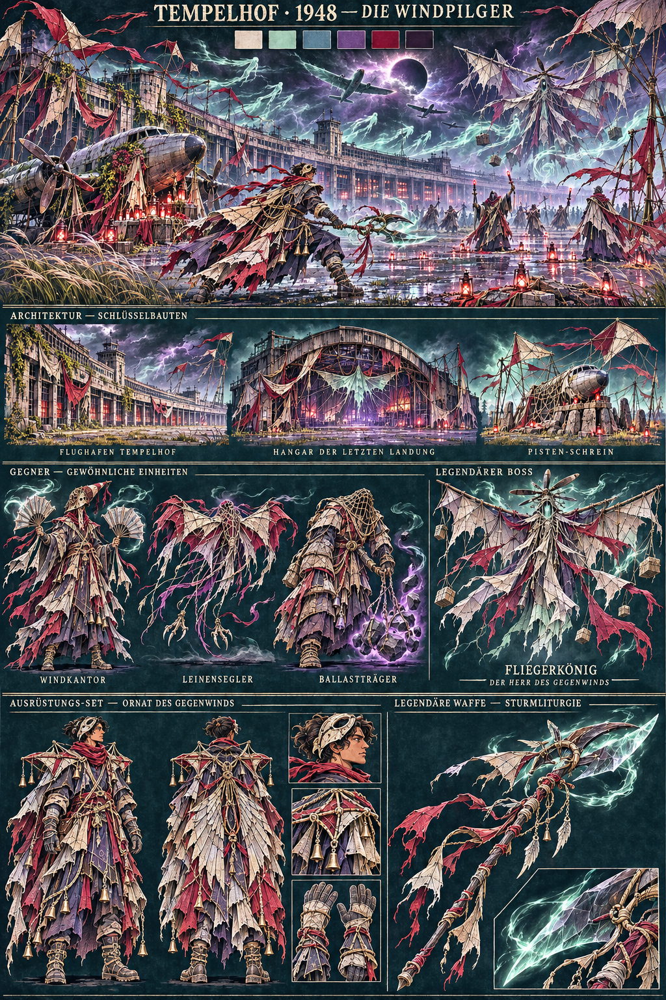

Selected B: a frightening airlift wind cult, spectral Rosinenbomber and dark
magic. Less zombie anatomy, engine machinery and gadget styling. Living masked
ritualists, possessed sailcloth and elaborate parachute vestments define it.
Ink-indigo, fog ivory, bruised violet, deep crimson, silver and mint witchlight;
St Elmo fire along ropes/wings, storm flashes, soul-vapor and red votive lamps.

| Element | Final concept brief |
|---|---|
| Buildings | Weathered curved Flughafen terminal; **Hangar der Letzten Landung**, a fabric/rope wind-cathedral; runway shrine made from aircraft nose, cargo net, field stone and ritual kites |
| Windkantor | Tall masked cantor, pointed windsock hood, layered robes and paired wing-fans; a ritualist silhouette rather than exposed zombie anatomy |
| Leinensegler | Low wide manta-like possessed parachute, knotwork face and tether claws; gliding cloth rather than a humanoid |
| Ballastträger | Broad net-veiled cult porter, weighted sleeves and an anchor of levitating coal/stone; the heavy silhouette |
| Legendary boss | **Fliegerkönig — Der Herr des Gegenwinds**: airborne faceless high priest, immense parachute/wing-spar halo, propeller-wood and cockpit-glass crown, trailing shrouds and ghostwind |
| Emblematic set | **Ornat des Gegenwinds**: indigo/ivory layered robes, kite-frame shoulders, crimson tether embroidery, spectacular split parachute cape, ivory aviator ritual mask and heavy boots |
| Legendary weapon | **Sturmliturgie**: ceremonial propeller glaive, dark wood/cockpit-glass blades, sailcloth vanes, wing charms and a levitating glass cutting edge held by ghostwind |

## Final · Wedding · kommt bald · Das ewige Fest

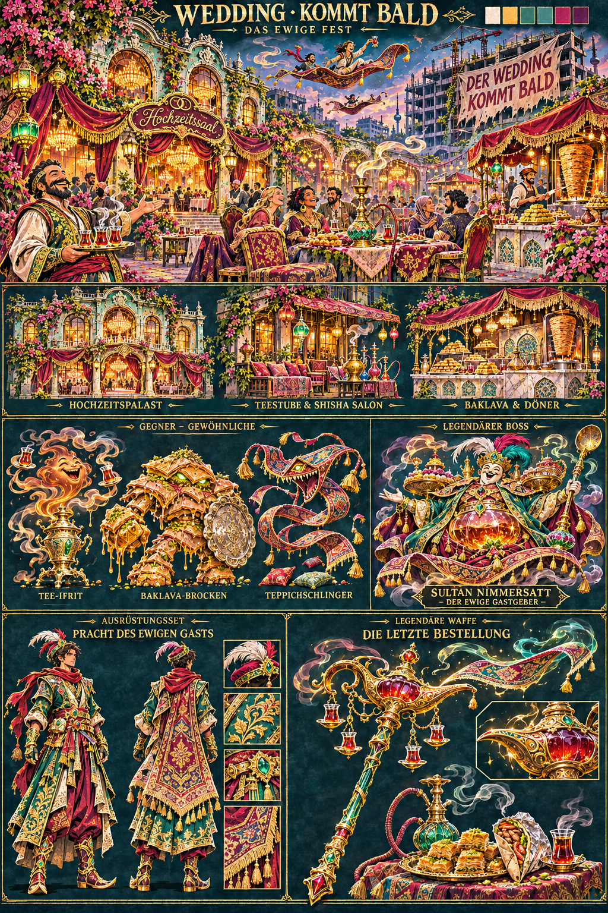

Selected C: extravagant gold/emerald banquet fantasy around a Berlin wedding
hall. Flying carpets, wish lamps, baklava, Döner, shisha, samovar and black tea
are tangible design elements. The era label is **“kommt bald”**; the large
development joke is **“Der Wedding kommt bald”**. No numeric year. Cranes and
unfinished luxury promises remain behind the feast, anchoring the joke.

Living neighbours are friendly hosts, traders and guests. The absurd enemies
are enchanted feast beings; their villainy is not a real-world faith or ethnic
identity. The tone is playful, lavish and mischievous rather than zombie horror.

| Element | Final concept brief |
|---|---|
| Buildings | Emerald/ruby/gold **Hochzeitspalast** inside weathered Berlin Altbau; **Teestube & Shisha Salon** with samovar/carpet terrace; **Baklava & Döner** pavilion with red awning, copper syrup vessels and pastry counters |
| Tee-Ifrit | Tall mischievous tea-vapor spirit emerging from a samovar, floating tulip tea-glass hands; amber smoke silhouette |
| Baklava-Brocken | Broad heavy filo/pistachio golem with honey-gold fists, emerald eyes and serving-tray shield; unmistakably enchanted pastry |
| Teppichschlinger | Long airborne carpet creature, woven face and tassel arms, acrobatic loops and floating cushions |
| Legendary boss | **Sultan Nimmersatt — Der Ewige Gastgeber**: fictional gold-vessel/porcelain/velvet banquet sovereign, jewelled crown, enormous serving-tray shoulders, glowing tea-urn belly and giant spoon sceptre, floating carpet throne on tea smoke |
| Emblematic set | **Pracht des Ewigen Gasts**: lavish emerald embroidered longcoat, ruby/magenta trousers, jewelled sash, gold gauntlets, feathered fashion cap and flying-carpet-pattern cape |
| Legendary weapon | **Die Letzte Bestellung**: enormous gold wish-lamp battle sceptre with emerald handle, ruby vessel, suspended tea glasses and magical smoke/cutting ribbon; supporting food/tea/shisha still life |

## Final · Charlottenburg · 1920 · Die diamantene Revue

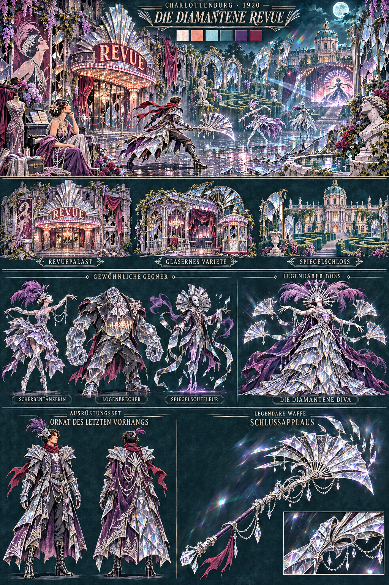

Selected A+C: Ku'damm's revue spectacle and extravagant performer couture meet
the Schloss's broken mirror fantasy. Silver, diamonds and cut glass dominate;
violet, pearl, ink-teal and berry accents replace the earlier gold grading.
White/pink stage bulbs, prism rays, reflections and diamond dust define light.
The Schloss retains localized baroque bleed; the district stays in 1920.

| Element | Final concept brief |
|---|---|
| Buildings | Silver fan-marquee **Revuepalast** in a worn Berlin theatre facade; **Gläsernes Varieté**, a shattered cabaret/conservatory; **Spiegelschloss**, recognisable palace dome, mirror gallery and hedge maze |
| Scherbentänzerin | Slender costumed crystal dancer, translucent diamond-panel dress, violet feathers and stage half-mask; elegant sharp silhouette |
| Logenbrecher | Broad smoked-glass bouncer in black tuxedo tails, silver cravat, enormous faceted fists and chandelier-like inner structure |
| Spiegelsouffleur | Tall floating hollow tailcoat, oval mirror mask, reflective fan collar and ribbon/film/shard arms; spectral theatrical silhouette |
| Legendary boss | **Die Diamantene Diva**: monumental tiered cut-glass fan gown, silver feathers/diamond halo, floating fan-blades, violet cape, luminous crystal heart and commanding stage-mask face |
| Emblematic set | **Ornat des Letzten Vorhangs**: silver/violet revue duellist coat, mirrored fan shoulders, pearl/diamond embroidery, crystal gauntlets, black patent boots and mirror-lined violet cape |
| Legendary weapon | **Schlussapplaus**: silver/cut-glass fan-blade glaive, violet conductor-baton handle, razor diamond crescent, pearl filigree and hovering glass tips held in prism light |

These names and silhouettes develop the final art brief. Combat roles, attacks,
stats, loot tables and replacing the old Wedding boss are future implementation
decisions. The weapon effects shown are visual concepts, not shipped features.

## Historical exploration · nine original alternatives

The original A/B/C boards below are preserved as history. Their logos,
transit-yellow paint, brown starter costumes and unused bosses are **not**
instructions for the final three districts. Final prompts/original outputs:
[`finals/`](../assets/raw/codex/16-district-design-boards/finals/).

## Tempelhof · 1948 airlift

All three keep the airport, hangars, Rosinenbomber ghosts, cargo cult and Feld
kites. The Fliegerkönig remains the story boss; these are appearance proposals.

| Pick | Direction | Architecture and atmosphere | Enemy / clothing / equipment language |
|---|---|---|---|
| A | Luftbrücke im Nebel | Monumental curved terminal, misty apron, humanitarian cargo, cold fog / amber lanterns | Aircrew and loadmaster Zeitlose, propeller-wing king; flight jacket, parachute webbing, propeller blade and radio pack |
| B | Die Windpilger | Open runway grassland, parachute shrines, kites and storm sunrise | Sailcloth frames, net crawler, wind-vane crown; parachute cape, ropes, windsock spear |
| C | Nachtschicht im Hangar | Dense steel-truss workshop, engine salvage and night-shift tungsten light | Riveter and radio ghoul, engine-armoured king; insulated apron, rivet hammer, valve-radio pack |

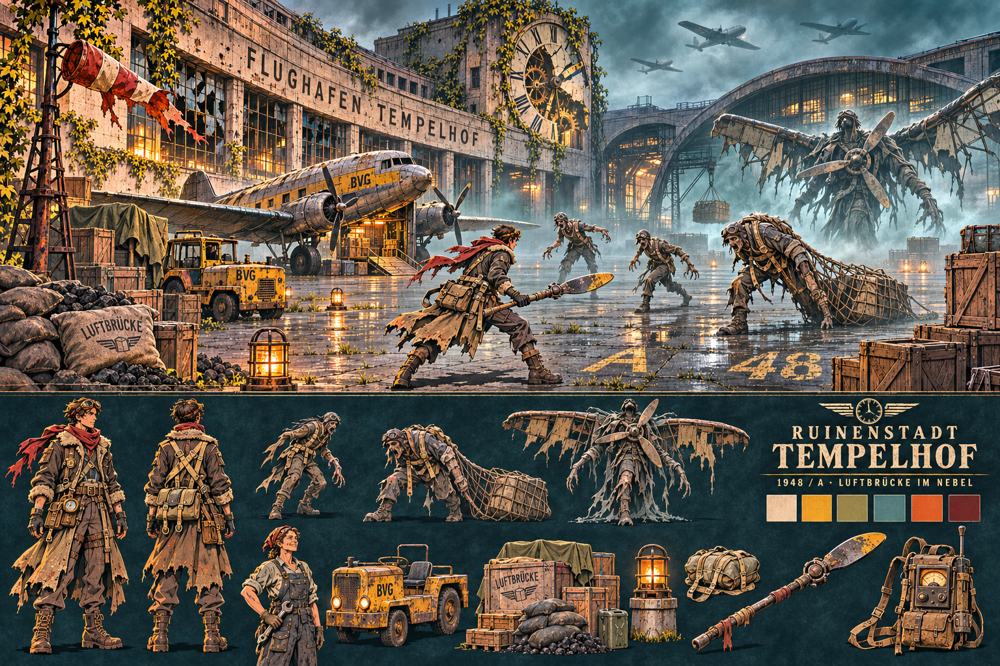
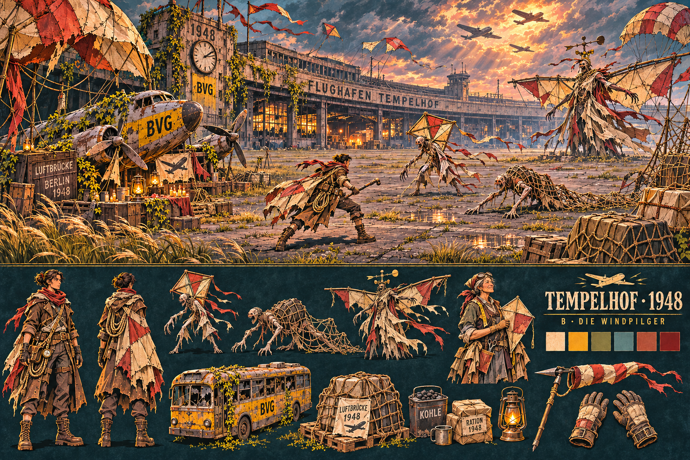
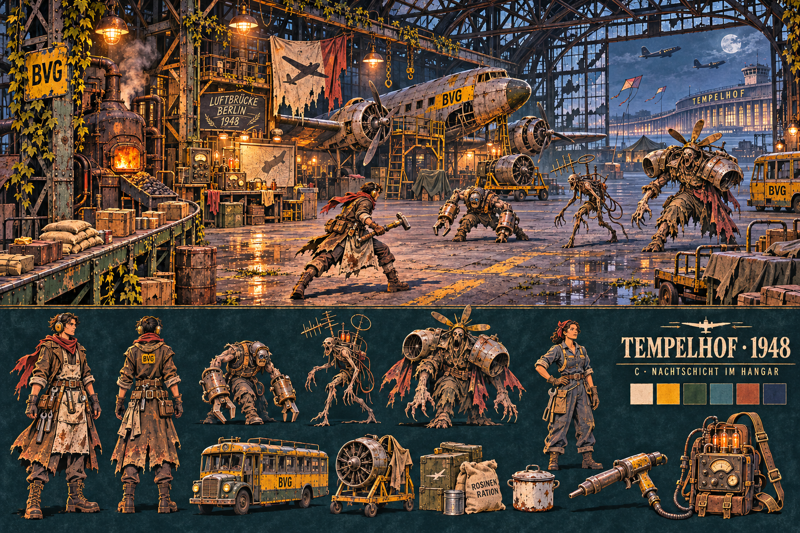

## Charlottenburg · 1920

All three use Ku'damm cinema, cabaret, jazz and Art Deco. Baroque bleed belongs
to the Schloss boss destination; the whole district does not move to 1700.
Named bosses below are proposals, not a replacement of the story's open slot.

| Pick | Direction | Architecture and atmosphere | Enemy / clothing / equipment language |
|---|---|---|---|
| A | Die letzte Revue | Cabaret facades, fan awnings, incandescent marquees, velvet / peacock teal | Feather-fan dancer, masked usher, Revuekönigin; velvet lapels, spotlight gun, enamel cane sword |
| B | Asphalt und Messing | Rainy Ku'damm, jazz cellar, cinemas, petrol / brass | Umbrella ghoul, safe-door enforcer, Ringverein boss; pinstripes, flat cap, scrap scattergun, knuckle gloves |
| C | Das Spiegelschloss | Ruined palace garden, mirror labyrinth, Deco cinema reflected in baroque fragments | Mirror double, marble stag, Spiegeldirektor; evening waistcoat, mirror gauntlet, silver blade, opera cloak |

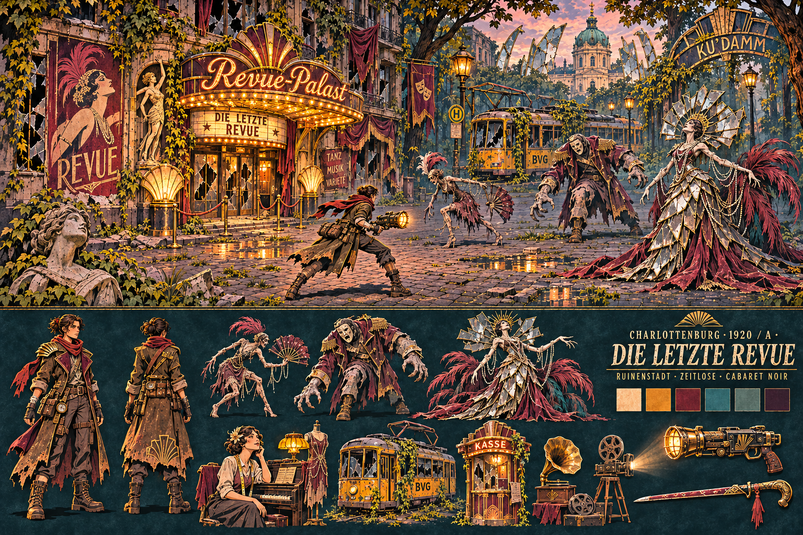
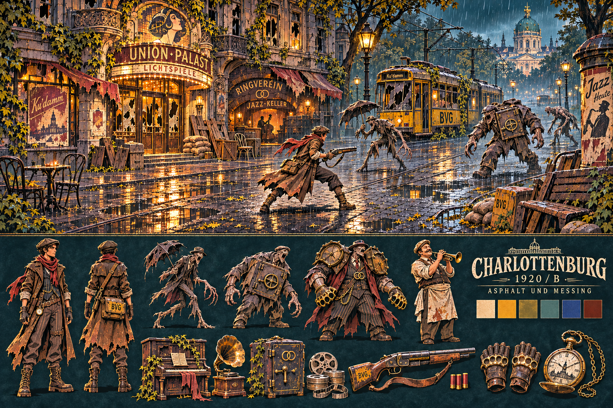
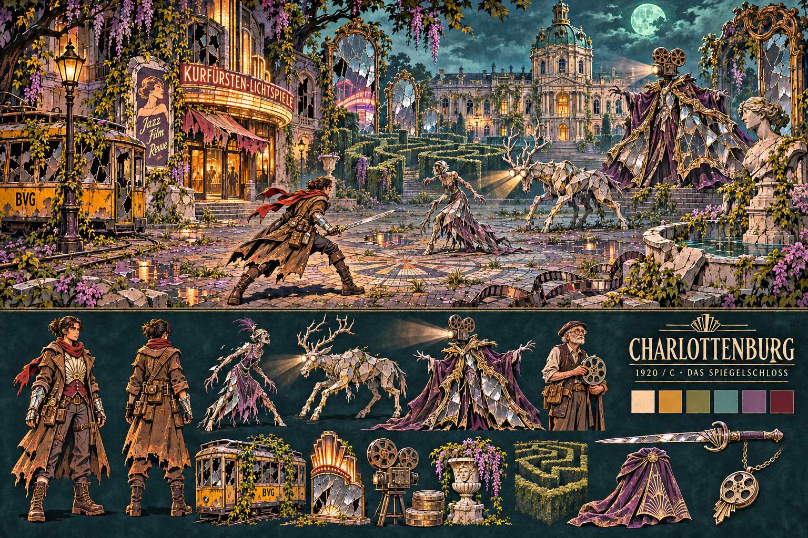

## Historical Wedding · the eternal “bald” (label superseded)

No invented numeric year. The Kiez and its Turkish, Lebanese and Arab families
are allies, traders and quest givers. The enemy is the developer's promise:
construction machinery, scaffold Zeitlose, billboard creatures and the Ewige
Bauherr. Clothing and community identity do not define enemy types.

| Pick | Direction | Architecture and atmosphere | Enemy / clothing / equipment language |
|---|---|---|---|
| A | Leopoldplatz bleibt | Survivor market, tea-house, bakery, Altbau beneath unfinished luxury promises | Plank-limbed scaffold ghoul, walking billboard, facade-chested crane golem; market apron, teal scale hammer, shutter shield |
| B | Pankelicht und Fabrikstaub | Panke canal, AEG/Osram redbrick, broken sawtooth roofs, copper / lamp orange | Construction drone, cable-tray ghoul, conversion-gantry golem; work oversmock, lamp-coil staff, cable gauntlets |
| C | Morgen wird gefeiert | Warm wedding-hall refuge against unfinished luxury tower, mint / berry / gold | Cement-sack ghoul, developer-brochure bird, tower golem; repaired formal waistcoat, chandelier lantern mace, tray shield |

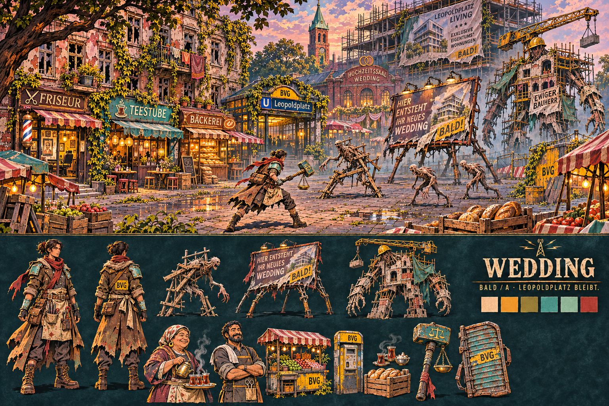
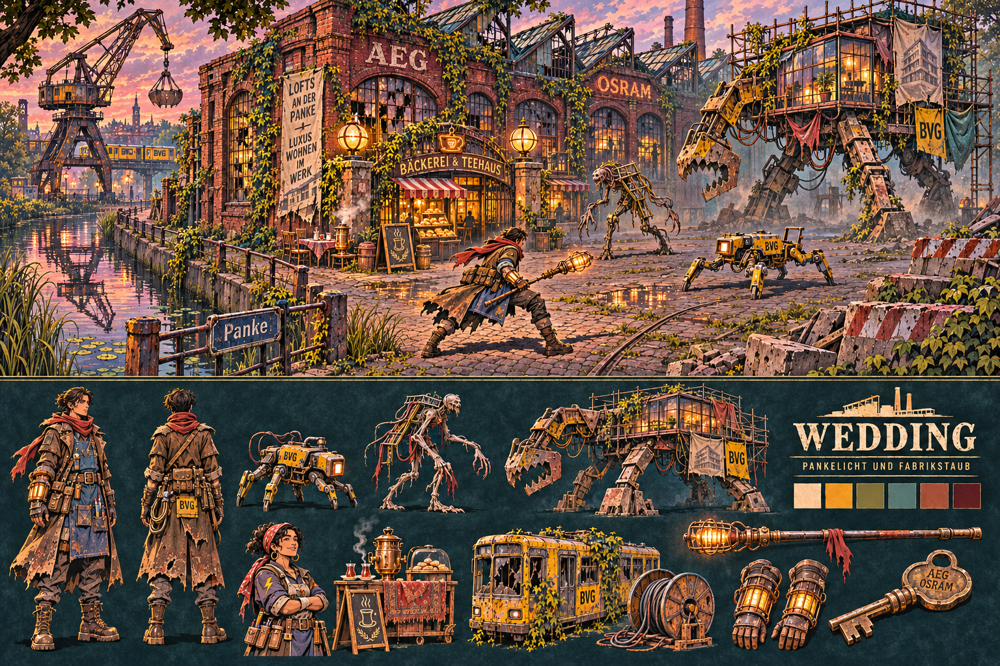
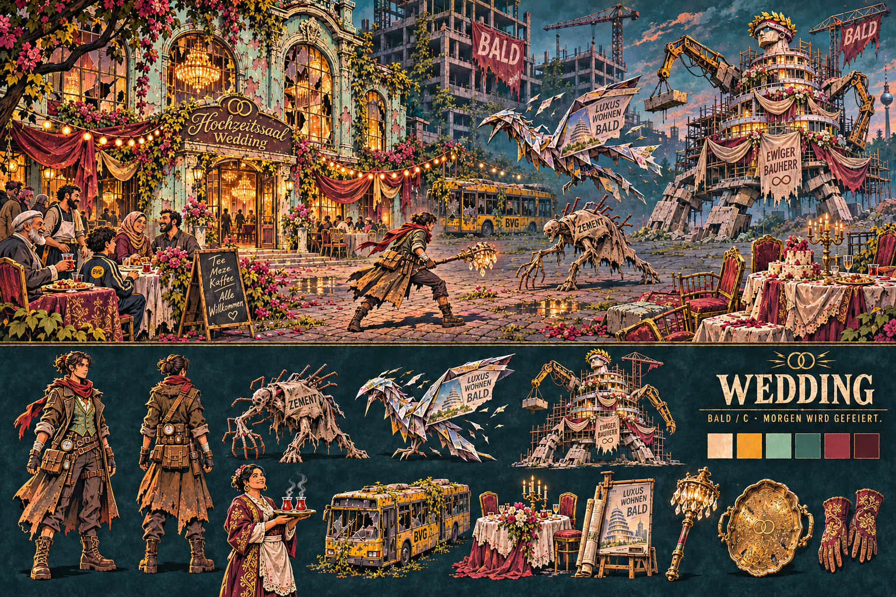

## Selection record and handoff

Johannes explicitly selected Tempelhof B, Wedding C and Charlottenburg A+C
and requested the listed refinements. Preserve all nine exploration boards as
history, and the existing Köpenick/U-Bahn/Mitte/GDR references. The three final
district boards supersede the old alternatives only for their own districts.

Next session: pickup/equipment gaps, then complete Köpenick/global building
foundation. Audit assets and renderer coverage first, reuse existing painted
art, preserve code glow, size icons from gameplay readability. Basic hookup
and at most one measurement run by Codex; optimization and deep tests by
Claude. See [workflow](../pipeline/workflow.md) and
[pickup task](../pipeline/tasks/15-pickups.md).

These boards are outside the runtime manifest and service-worker shell. Added
game texture memory: **0 bytes**. Frame milliseconds / 5% regression: **not
measured, not applicable to this documentation-only batch**. This does not
establish that a future integrated asset batch meets its performance budget.
